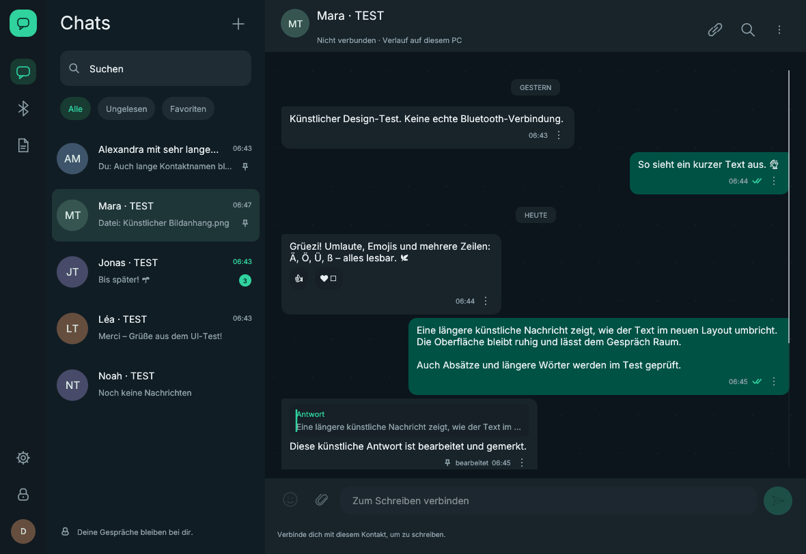

# Hushlink

Hushlink ist ein lokaler, Ende-zu-Ende-verschlüsselter 1:1-Chat mit Dateiversand für zwei Windows-11-PCs in Bluetooth-Reichweite. Nachrichten und Dateien benötigen weder Internet noch Konto oder zentralen Server. Nur die abschaltbare Update-Funktion nutzt Internet. Keine Telemetrie. Die deutsche Oberfläche und die App-Logik sind in Rust geschrieben.

**Vorabversion:** Die automatischen Prüfungen und Windows-Builds stehen im jeweiligen [Actions-Lauf](https://github.com/747elias/Hushlink/actions). Ein erfolgreicher Build ist kein Bluetooth-Hardwaretest. Der konkrete Zwei-PC-Testplan ist [hier](docs/MANUAL-TEST.md) beschrieben. Es besteht keine externe Sicherheitsprüfung.

## Entwicklungsstand v0.4.0

Auf `feature/messenger-redesign` sind zusätzlich Antworten/Zitate,
Emoji-Reaktionen, gekennzeichnete Bearbeitungen, optionale Schreibanzeige,
Volltextsuche und gemerkte Nachrichten implementiert. Dazu kommen Kontakt-
Stummschaltung, Anfragebegrenzung, Übertragungsrate/Restzeit, bestätigter
Bildversand aus der Zwischenablage, QR-/Kameravergleich, optionaler kryptografisch
gebundener Windows-Hello-Zugang sowie verschlüsselte automatische Sicherungen
mit Wiederherstellung und Speicherverwaltung.

**Noch kein v0.4-Release:** Der Nutzer besitzt noch kein Code-Signing-Zertifikat
oder verifizierten Dienst. Die Signierpipeline ist vorbereitet und blockiert
unsignierte Veröffentlichungen. [Einrichtung und externer Schritt](docs/SIGNING.md).
Die zuletzt veröffentlichten v0.3-Downloads unten enthalten diese Erweiterungen
noch nicht. Konkrete Nachweise und verbleibende Hardwaretests stehen im
[Prüfstand](docs/VALIDATION.md), [v0.4-Arbeitsstand](docs/RELEASE-v0.4.0.md) und
[manuellen Testablauf](docs/MANUAL-TEST.md).

## Neue Messenger-Oberfläche im Entwicklungsbuild

Das Design orientiert sich an vertrauten Desktop-Messengern: dunkles Petrol,
Mint-Akzente, eingebettete Inter-Schrift, eigene Icons und kompakte Chatblasen.
Die bisher veröffentlichten v0.3-Downloads enthalten dieses Design noch nicht.



Die Abbildung zeigt die laufende Linux-Entwicklungsansicht mit künstlichen Daten,
keinen Hardwaretest. Windows verwendet den nativen MSVC-/Direct3D-Build.

- Links: Chats, neue Bluetooth-Verbindung und Dateiübertragungen. Das Plus öffnet
  Empfang/Suche; der Verbindungsassistent bleibt dort erreichbar.
- Kontakte mit letzter Nachricht, Uhrzeit und ungelesenem Zähler; Suche sowie
  Filter **Alle**, **Ungelesen** und **Favoriten**. Kontextmenü zum Verwalten.
- Im Chatkopf: erneut verbinden, Nachrichtensuche und **Chat-Menü**. Das Menü
  enthält Kontaktverwaltung, lokales Löschen und Trennen.
- An einer Nachricht das Dreipunktmenü für Merken, Antworten, Reagieren oder
  Bearbeiten verwenden. Die verfügbaren Aktionen richten sich nach echtem
  Verbindungs- und Bestätigungszustand. Zwei Häkchen bedeuten weiterhin eine
  verschlüsselte Speicherbestätigung, keine Lesebestätigung; mit der Maus darüber
  erscheint die Erklärung. Unter Windows zeigen Zeitstempel die lokale Uhrzeit.
- Das Büroklammermenü im Eingabebereich bietet Dateien und Bilder an;
  der Downloadknopf am gespeicherten Anhang exportiert bewusst Klartext.
  Ohne bestätigte Verbindung bleibt die Eingabe gesperrt.
- Unten links: Einstellungen, Schloss und Profil. Die Einstellungen sind in
  **Allgemein**, **Privatsphäre**, **Sicherheit** und **Speicher** gegliedert.
  Tresorpfad, Autostart und Updates stehen unter Allgemein, Passwort/Hello und
  Inaktivität unter Sicherheit, verschlüsselte Sicherungen unter Speicher.

[Designplan und Prüfstand](docs/PLAN-DESIGN.md). Für die folgenden allgemeinen
Einrichtungsschritte gelten bei v0.3 noch dessen ursprüngliche Bedienelemente.

## Starten und benutzen

1. Unter [Releases](https://github.com/747elias/Hushlink/releases) **Hushlink-v0.3.0-windows-x64-setup.exe** herunterladen, SHA-256 mit `Get-FileHash` gegen `SHA256SUMS.txt` vergleichen und als normaler Benutzer installieren. Installation unter `%LOCALAPPDATA%\Programs\Hushlink`, mit Startmenü und Deinstallation. Alternativ die separate EXE direkt starten oder das ZIP vollständig entpacken. Öffentliche Downloads benötigen kein GitHub-Konto.
2. EXE als normaler Benutzer starten. Windows 11 x64, eine funktionierende Direct3D-12-Grafikumgebung (gegebenenfalls Windows-Softwareadapter) und ein Bluetooth-Classic-Adapter mit Microsoft-RFCOMM-Unterstützung werden benötigt. Reine BLE-Adapter reichen nicht. Die EXE verwendet die statische MSVC-Laufzeit; weder Rust noch eine zusätzliche App-Registrierung oder ein MSIX-Paket sind erforderlich. Es gibt keinen TCP- oder WLAN-Ersatztransport.
3. Einen Anzeigenamen und ein langes, einzigartiges Passwort (mindestens 12 Zeichen) festlegen. Das Passwort verschlüsselt tatsächlich den lokalen Tresor. **Es gibt keine Passwortwiederherstellung. Ein vergessenes Passwort bedeutet Datenverlust.**
4. Bluetooth auf beiden PCs in den Windows-Einstellungen einschalten. Bei Bedarf beide PCs dort koppeln. Zum erstmaligen Finden Windows-Bluetooth-Einstellungen geöffnet halten; Windows steuert die Sichtbarkeit. Hushlink aktiviert selbst keine dauerhafte Auffindbarkeit.
5. Auf einem PC **Verbindung empfangen** wählen. Auf dem anderen **Geräte suchen**, den richtigen PC und **Verbinden** wählen. Die Suche zeigt Geräte-Kandidaten; erst der Verbindungsaufbau prüft den Hushlink-Dienst. Eingehende Anfragen bewusst annehmen oder ablehnen. Nur eine Verbindung gleichzeitig.
6. Auf beiden PCs den vollständigen Sicherheitscode über einen unabhängigen Weg vergleichen, zum Beispiel persönlich. Ein Gerätename genügt nicht. Auf beiden Seiten bestätigen. Erst dann wird das Schreiben freigegeben. Eine geänderte bekannte Identität blockiert die Verbindung; eine neue Prüfung verlangt eine bewusste Entscheidung.
7. Text schreiben: **Enter** sendet, **Shift+Enter** fügt eine neue Zeile ein. Unicode, Umlaute, Emojis und Zeilenumbrüche werden als UTF-8 übertragen. Ausstehend bedeutet lokal vorgemerkt, gesendet bedeutet in die Verbindung geschrieben und **empfangen** bedeutet durch die andere App nach verschlüsselter Speicherung bestätigt. Das ist keine Lesebestätigung.
8. Kontakte und Verlauf bleiben im verschlüsselten lokalen Tresor erhalten. Kontakt auswählen und **Erneut verbinden** nutzen. Jeder Verbindungsaufbau verwendet eine neue Sitzung. Bei bereits bestätigten Kontakten prüft jede App den gespeicherten Schlüssel und bestätigt die neue Sitzung automatisch. Neue oder geänderte Identitäten benötigen wieder eine bewusste Prüfung.
9. **Sperren** oder **Strg+L** beendet Sitzungen und leert die Anzeige. Die automatische Sperre nach 1–120 Minuten ist in den Einstellungen konfigurierbar (Standard 5 Minuten); das Sperren der Windows-Sitzung sperrt Hushlink ebenfalls. In den Einstellungen lässt sich das Passwort ändern, der Verlauf bleibt dabei erhalten.
10. **Verlauf löschen** entfernt den ausgewählten Verlauf aus dem lokalen Tresor. Kopien auf dem anderen PC bleiben bestehen. Sichere physische Löschung auf SSDs wird nicht versprochen.
11. **Datei senden** wählt eine Datei bis 20 MiB. Die andere Person muss das Angebot ausdrücklich annehmen. Fortschritt und Abbruch stehen unter **Dateiübertragungen**. Erst nach bestätigter Speicherung erscheint die Datei als empfangen. Anhänge bleiben verschlüsselt im Tresor; **Speichern unter** erzeugt bewusst eine entschlüsselte Kopie. Dateien werden nie automatisch geöffnet. Vorsicht bei unbekannten Dateien.
12. In **Einstellungen** den Tresorpfad wählen: gesperrt einen vorhandenen Tresor oder einen Speicherort für ein neues Profil auswählen, entsperrt den Tresor nach dem Trennen sicher verschieben. Alle privaten Daten bleiben zusammen in einer Datei. Bestehende Zieldateien werden nicht überschrieben.
13. Dort auch Windows-Autostart, Schliessen ins Tray und automatische Updates einstellen. Autostart öffnet einen gesperrten Tresor. Schliessen ins Tray sperrt zuerst und beendet Verbindungen; über das Tray-Menü **Beenden** vollständig schliessen. Updates werden beim Start und alle sechs Stunden geprüft/heruntergeladen, installiert erst nach **Update installieren und neu starten**. Dies benötigt Internet; ausgeschaltet bleibt der Chat vollständig offline nutzbar.

14. **Verbindungsassistent** begleitet Adapterprüfung, Windows-Pairing, Auswahl von Empfang oder Suche und den beidseitigen Sicherheitscode. Die Zustände stammen von der tatsächlichen Verbindung. Ein Suchergebnis oder Gerätename beweist keine Identität.
15. Dateien können auch per **Drag & Drop** ins ausgewählte verbundene Gespräch gelegt werden. Bis zu 16 lokale Dateien vormerken und jede bewusst anbieten. Die andere Person muss annehmen; Ordner und Dateien ohne lokalen Pfad werden abgewiesen.
16. Nach Unterbruch neu mit demselben bestätigten Kontakt verbinden. Bei der fehlgeschlagenen ausgehenden Datei im Verlauf **Erneut anbieten / fortsetzen** wählen. Der Empfänger nimmt erneut an; vorhandene verschlüsselte Bytes werden geprüft und übersprungen. Auch nach App-Neustart möglich. **Abbrechen/Ablehnen** verwirft den empfangenen Dateiteil; **Fortsetzungspunkt löschen** entfernt den lokalen Teilstand. Nach abruptem Absturz kann der letzte noch nicht gesicherte Abschnitt erneut übertragen werden.
17. Unter **Kontakt verwalten** eigene Namen und Favoriten setzen, bestätigte Geräteinformationen ansehen oder einen Kontakt samt lokalem Verlauf bewusst entfernen. Eigene Namen werden nur lokal verschlüsselt gespeichert und ersetzen keine Identitätsprüfung. Ungelesene Zähler verschwinden beim Lesen des ausgewählten Gesprächs.
18. **Private Windows-Benachrichtigungen** lassen sich im entsperrten Tresor einstellen. Bei neuer Aktivität im Hintergrund erscheinen Hinweise ohne Namen, Dateinamen oder Textvorschau und ein ungelesener Zähler im Tray-Tooltip. Windows kann Mitteilungen unterdrücken. Das Sperren verwirft ausstehende Hinweise. Schliessen ins Tray sperrt und trennt weiterhin; zum Empfang im Hintergrund die entsperrte App minimieren.

Die Anwendung ist nicht mit einem vertrauenswürdigen Herausgeberzertifikat signiert. Windows SmartScreen kann warnen. Prüfsummen belegen Dateikonsistenz, keine Herausgeberidentität. Keine unnötigen Administratorrechte erteilen.

## Lokale Daten und Grenzen

Der Standardpfad liegt im lokalen Windows-App-Datenordner (`%LOCALAPPDATA%\Hushlink\Hushlink\data\profile.vault`), nicht neben der EXE. In den Einstellungen lässt sich der Speicherort wählen. Profil, private Schlüssel, Kontakte, Nachrichten und Anhänge liegen gemeinsam in dieser verschlüsselten Datei. `hushlink-settings.json` im Standardordner enthält ausschließlich den Startverweis auf den Pfad und nicht geheime Desktop-Einstellungen. Eine leere `.lock`-Datei enthält keine Chatdaten. Nur ausdrücklich exportierte Anhänge erzeugen Klartextdateien. Keine automatischen Klartext-Backups, Chat-Logs oder Crash-Reports. Ein optionaler nicht exportierbarer Windows-Hello-Geräteschlüssel bleibt beim Windows-Schlüsselanbieter; der Passwortzugang zur Tresordatei funktioniert auch ohne ihn. Windows kann unabhängig davon Speicherabbilder, Auslagerungsdateien und Systembackups erzeugen.

Für eine manuelle Explorer-Kopie den Tresor zuerst schliessen. Ab v0.4 erzeugt die App selbst geprüfte verschlüsselte Sicherungen; jede Kopie benötigt das zum Sicherungszeitpunkt gültige Passwort. Eine beschädigte oder von aussen geänderte Datei wird nicht automatisch ersetzt. Betriebssystemverschlüsselung wie BitLocker ergänzt den App-Tresor. Ein entsperrtes oder kompromittiertes Gerät bleibt ein Risiko. [SECURITY.md](SECURITY.md) beschreibt das Bedrohungsmodell und die Grenzen einschliesslich Metadaten und lokal gespeicherter Nachrichten.

Vor dem Wechsel auf v0.3 den geschlossenen Tresor sichern. v0.3 liest vorhandene v0.1-/v0.2-Profile, speichert jedoch ein erweitertes Format für die neue App. Beide Chatpartner müssen v0.3 verwenden. Bereits bestätigte Identitätsschlüssel bleiben vertrauenswürdig; neue und geänderte Kontakte brauchen weiterhin den beidseitigen Codevergleich. Deinstallation entfernt die App, bewahrt Tresore und Einstellungen.

## Bedienung der Erweiterungen v0.4

- Im Dreipunktmenü einer Nachricht **Antworten**, **Reagieren** oder bei eigenen Texten
  **Nachricht bearbeiten** wählen. Änderungen bleiben bis zur verschlüsselten Bestätigung
  als unbestätigt gekennzeichnet. Nach Abbruch neu verbinden und ausstehende
  Änderungen im Chat explizit erneut übertragen. Der ursprüngliche Text kann bei
  der Gegenstelle oder in Sicherungen weiterhin als Kopie vorhanden sein.
- Mit **Nachricht merken** Nachrichten lokal anheften. Die Lupe im Chatkopf,
  **Alle Chats** und **Gemerkte** filtern den entsperrten Verlauf; der Index bleibt im Speicher.
- In Einstellungen die standardmässig ausgeschaltete Schreibanzeige einschalten.
  Unter Kontakt verwalten Hinweise für eine Stunde/einen Tag oder dauerhaft
  stummschalten. Ungelesene Zähler bleiben sichtbar. Unbekannte Anfragen lassen
  sich zeitweise oder dauerhaft sperren; ohne Sperre höchstens eine alle zehn Sekunden.
- Nach Kopieren eines Screenshots **Strg+V** im Nachrichtenfeld oder **Bild einfügen**
  wählen. Bis 16 Megapixel und 20 MiB PNG. Erst **Bild ausdrücklich anbieten**
  überträgt das Angebot; die Gegenstelle muss annehmen. Keine Klartext-Temporärdatei.
- Beim ersten Sicherheitsvergleich **QR-Code und Kameravergleich** wählen, den
  Code des anderen PCs scannen und weiterhin auf beiden Geräten bestätigen.
  Kamera nur während der bewussten Prüfung; Nummer bei mehreren Kameras wechseln.
  Windows muss Desktop-Apps Kamerazugriff erlauben. Keine zusätzliche Laufzeit
  oder Paketregistrierung; unkomprimierte Media-Foundation-Kameraformate nötig.
  Windows N/KN benötigt nur für die Kamerafunktion das optionale Microsoft Media
  Feature Pack; die verzögert geladenen Kamera-DLLs sind keine Chat-Startvoraussetzung.
- Optional in Einstellungen mit aktuellem Passwort **Windows Hello einrichten**.
  Funktioniert nur mit einem geeigneten Passport-KSP und erneuter Bestätigung
  bei jedem privaten Zugriff. Bei fehlender Unterstützung Passwort verwenden.
  [Technische Voraussetzungen und Grenzen](docs/WINDOWS-HELLO.md).
- Sicherungsordner, Intervall und Aufbewahrung wählen (Standard täglich/fünf
  Kopien). Sicherungen laufen nur entsperrt und enthalten ausschliesslich
  verschlüsselten Ciphertext. Im gesperrten Zustand **Verschlüsselte Sicherung
  wiederherstellen** wählen: Quelldatei, neues freies Ziel und damaliges Passwort.
  Bestehende Tresore werden nicht überschrieben. Alte Sicherungen bleiben mit
  alten Zugangsschlüsseln lesbar.
- **Speicherübersicht und gezieltes Löschen** entfernt einzelne lokale Einträge
  samt Anhang nach Trennung. Gegenstelle, Exporte und ältere Sicherungen bleiben
  erhalten. Verschlüsselte Bestätigungs-IDs/Digests verhindern das Wiederanlegen
  gelöschter Antworten durch späte Wiederholungen; Kontaktentfernung löscht sie mit.

Beide PCs brauchen v0.4 für Protokoll 4. Vor dem ersten Speichern mit v0.4 eine
verschlüsselte Kopie behalten: Profilschema 4 wird von älteren Apps abgewiesen.
Hello-Einrichtung erweitert die Hülle auf Version 2; Passwortzugang bleibt erhalten.

## Bauen

Voraussetzung: Rust über rustup sowie unter Windows Visual Studio 2022 Build Tools mit **Desktopentwicklung mit C++** und Windows SDK. `rust-toolchain.toml` fixiert Rust; `Cargo.lock` fixiert die vollständige Abhängigkeitsauflösung. Die GitHub Actions bauen das endgültige Binary mit MSVC auf einem echten Windows-Runner.

```powershell
rustup target add x86_64-pc-windows-msvc
cargo fmt --check
cargo clippy --locked --all-targets --target x86_64-pc-windows-msvc -- -D warnings
cargo test --locked --target x86_64-pc-windows-msvc
cargo build --locked --release --target x86_64-pc-windows-msvc
.\target\x86_64-pc-windows-msvc\release\hushlink.exe
```

Unter Linux lassen sich die plattformunabhängigen Protokoll-, Tresor- und Akteurtests ausführen. Die Desktop-App zeigt dort ausdrücklich fehlende Windows-Bluetooth-Unterstützung an. Der Testtransport ist strikt auf Tests beschränkt. Ein Linux-Build ersetzt weder MSVC noch Hardwaretests.

## Fehlerbehebung

- **Kein Adapter/Funk deaktiviert:** Windows-Bluetooth-Einstellungen und Gerätemanager prüfen, Herstellertreiber aktualisieren, sicherstellen, dass Classic/RFCOMM unterstützt wird. Ein USB-BLE-Dongle ist nicht automatisch geeignet.
- **Kein Gerät sichtbar:** Beide Geräte in Reichweite bringen, Windows-Sichtbarkeit/Pairing prüfen, Empfang auf dem anderen Hushlink aktivieren und Suche bewusst wiederholen. Funkumgebungen können die Reichweite stark reduzieren.
- **Dienst fehlt/Verbindung scheitert:** Auf der Gegenstelle Hushlink-Empfang aktivieren. Windows-Pairing abschliessen. Der stabile eigene Dienst wird per SDP registriert; keine fremden seriellen COM-Dienste verwenden.
- **Windows-Zugriff verweigert:** Windows-Bluetooth-Datenschutz-, Geräte- und Unternehmensrichtlinien prüfen. Hushlink umgeht keine Richtlinien. Details zur nativen API und benötigten Voraussetzungen stehen in [BLUETOOTH.md](docs/BLUETOOTH.md).
- **Zeitlimit/Unterbruch:** Empfang stoppen, trennen und neu verbinden. Ein neuer Handshake ist erforderlich; Nachrichten ohne Empfangsbestätigung können nach einem Abbruch als fehlgeschlagen erscheinen, obwohl die andere Seite sie bereits erhalten hat. Kein automatisches erneutes Senden.
- **Sicherheitscode verschieden/Identität geändert:** Nicht bestätigen. Verbindung trennen und unabhängig klären. Erst nach bewusster Entscheidung neu prüfen.
- **Falsches Passwort/beschädigter Tresor:** Datei unverändert lassen, Passwort prüfen oder eine eigene gesicherte Kopie wiederherstellen. Keine automatische Neuanlage über eine bestehende Datei. Keine Wiederherstellung durch den Entwickler möglich.
- **Windows-Sperrüberwachung noch nicht bereit:** Kurz warten und erneut versuchen. Wenn die Meldung bleibt, Windows-Sitzungsdienste und Richtlinien prüfen und die App neu starten. Das Profil wird ohne aktive Sperrüberwachung nicht entsperrt.
- **Profil bereits geöffnet:** Andere Hushlink-Instanz schliessen. Eine verbleibende leere Sperrdatei ist normal; die Betriebssystem-Dateisperre wird beim Prozessende freigegeben.
- **Tresor voll:** Alte lokale Verläufe samt Anhängen löschen. Grenzen: 128 MiB verschlüsselter Tresor, insgesamt 80 MiB Anhangsdaten, 1.000 Anhänge, 10.000 Nachrichten, 500 Kontakte, 16 KiB Text pro Nachricht. Sitzungen sind ebenfalls begrenzt; bei einer langen Unterhaltung neu verbinden.
- **Hello/Kamera nicht verfügbar:** Windows-Hello-Einrichtung und Kamerazugriff für Desktop-Apps prüfen. Bei ungeeigneten Treibern/Providern Passwort und vollständigen manuellen Codevergleich verwenden; Hushlink umgeht keine Schutzrichtlinie.
- **Update nicht möglich:** Internet/GitHub-Erreichbarkeit prüfen oder den neuen Installer manuell aus Releases laden. Updates benötigen keine Zugangsdaten. Bei Fehlern bleibt die bisherige App nutzbar. Für manuelle Installation eine noch laufende Instanz über das Tray beenden. Keine Sicherheitswarnung durch Eingabe eines GitHub-Tokens umgehen.

## Architektur und Mitwirkung

- `src/ui.rs`: egui/eframe, deutsche Oberfläche und UI-Sperrlifecycle.
- `src/runtime.rs`: Hintergrundakteur, Tresorlebenszyklus, Verbindungen und Nachrichtenstatus.
- `src/transport/`: natives Windows-Bluetooth-Classic/RFCOMM; kein IP-Fallback.
- `src/protocol.rs`: Noise-Sitzung, gegenseitige Vertrauensbestätigung und begrenzte Frames.
- `src/vault.rs`: authentifizierte Verschlüsselung, Passwortwechsel und atomare Speicherung.
- `src/storage_location.rs`: minimaler Startverweis und sichere Tresorverlagerung.
- `src/desktop/`, `src/updater.rs`: Windows-Tray, Autostart und begrenzte HTTPS-Update-Downloads.

[Prüfstand](docs/VALIDATION.md) · [Interne Prüfung](docs/SECURITY-REVIEW.md) · [Protokoll](docs/PROTOCOL.md) · [Tresorformat](docs/VAULT.md) · [Zwei-PC-Test](docs/MANUAL-TEST.md) · [Änderungen](CHANGELOG.md) · [Projektregeln](AGENTS.md).

Versionstags führen vor der Veröffentlichung dieselben Prüfungen und einen neuen Windows-Release-Build samt Installer-Abnahme für genau den Tag-Commit aus. Erst erfolgreiche Checks erlauben Veröffentlichung der exakt geprüften Dateien. Release-Artefakte enthalten Setup-EXE, direkt startbare EXE, ZIP und geprüfte SHA-256-Werte. [Installation](installer/README.md) · [Update-Vertrauen und Grenzen](docs/UPDATES.md).
